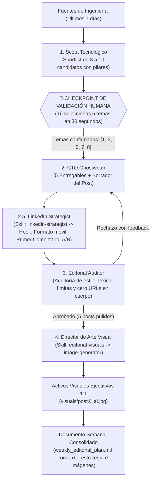

# Sistema de Agentes: Ghostwriter Ejecutivo para LinkedIn (CTO Edition)

Este repositorio contiene la arquitectura, prompts del sistema y flujo operativo de los agentes colaborativos diseñados para curar, validar, analizar y redactar contenido de liderazgo técnico para LinkedIn con voz de CTO experimentado.

---

## 🎯 Objetivo del Sistema

Transformar los eventos y novedades de ingeniería más relevantes de los últimos 7 días en **5 publicaciones estratégicas para LinkedIn**, eliminando el 100% del hype de marketing y enfocándose exclusivamente en tus áreas de expertise:
- IA aplicada al desarrollo de software y AI Assisted Development.
- Productividad de equipos de ingeniería, Developer Experience y SDLC.
- DevOps, CI/CD y Platform Engineering.
- Arquitecturas escalables y sistemas distribuidos.
- Liderazgo tecnológico, gestión ágil y cultura de ingeniería.

---

## 🤖 Los Agentes y sus Roles

| Agente | Nombre Interno | Rol Principal | Responsabilidad |
| :--- | :--- | :--- | :--- |
| **1. Scout Tecnológico** | `scout_curator` | Radar & Curador Especializado | Rastrea blogs de ingeniería de referencia y genera una **Shortlist de 8 a 10 temas** clasificados por pilares de tu perfil. |
| **🛑 Checkpoint Humano** | *Usuario (Tú)* | Validador Editorial | Seleccionas en 30 segundos los 5 temas que dominas y deseas publicar esa semana. |
| **2. Ghostwriter Ejecutivo** | `cto_ghostwriter` | Redactor estratégico | Genera el Resumen, Por qué importa, Tendencia, Opinión diferenciada y el borrador del Post de LinkedIn (250-500 palabras) para los 5 temas elegidos. |
| **2.5. Estratega de Distribución** | `linkedin_strategist` | Growth Strategist & Editor | Optimiza hooks ($\le 180$ chars), legibilidad móvil, extrae URLs al Primer Comentario y genera variantes A/B mediante el skill `linkedin-strategist`. |
| **3. Auditor de Calidad** | `editorial_auditor` | Gatekeeper y Editor en Jefe | Valida límites de palabras, ausencia de clichés ("game changer", "revolución"), cero enlaces en el cuerpo, consistencia de voz y ensambla el documento final. |
| **4. Director de Arte Visual** | `editorial_art_director` | Diseñador Visual Editorial | Traduce cada post auditado en un activo visual 1:1 de alto impacto (estética suiza minimalista) usando el skill `editorial-visuals`. |

---

## 🔄 Flujo Operativo con Validación Humana y Dirección de Arte



---

## 🚀 Guía de Instalación y Ejecución en Antigravity

Cualquier usuario que clone o descargue este repositorio puede ejecutar el pipeline de forma nativa en **Antigravity** sin necesidad de configurar servidores externos, bases de datos o dependencias complejas de Python.

---

### 1. Prerrequisitos

* Tener instalado **Google Antigravity** ([Antigravity IDE](https://antigravity.google) o la CLI `agy`).
* Una cuenta conectada a Antigravity con acceso a modelos Gemini con capacidad de herramientas y generación de imágenes (el subagente nativo `image-generator` viene integrado por defecto en Antigravity).

---

### 2. Clonar y Abrir el Proyecto

Abre tu terminal, clona el repositorio y ábrelo como espacio de trabajo en Antigravity:

```bash
# 1. Clonar el repositorio
git clone <URL_DEL_REPOSITORIO>

# 2. Entrar al directorio del proyecto
cd antigravity

# 3. Abrir el espacio de trabajo en Antigravity
agy .
```

> **Alternativa desde la interfaz gráfica:** Abre la aplicación de escritorio de **Antigravity IDE**, ve a `File` > `Open Folder...` y selecciona la carpeta del repositorio clonado.

---

### 3. Cómo Antigravity Carga el Pipeline

Una vez abierto el espacio de trabajo, Antigravity detecta y asocia automáticamente la arquitectura:

* **Descubrimiento de Skills:** Las carpetas `.agents/skills/linkedin-strategist/` y `.agents/skills/editorial-visuals/` son indexadas como **Workspace Skills** nativos. El asistente sabe cómo activarlos para optimizar retención en LinkedIn y estructurar briefs editoriales suizos en formato 1:1.
* **Roles de Agentes:** Los prompts y directivas en `agents/` (`scout.md`, `ghostwriter.md`, `strategist.md`, `auditor.md` y `art_director.md`) son consumidos por el asistente como guías maestras de ejecución.
* **Generación Visual Nativa:** El skill se apoya directamente en el subagente nativo `image-generator` de Antigravity, por lo que las imágenes se previsualizan y descargan directamente dentro del chat.

---

### 4. Paso a Paso: Ejecución del Pipeline Semanal

Una vez abierto el proyecto en Antigravity, abre el **panel de Chat** y sigue estos pasos:

#### Paso 1: Iniciar la Curaduría
Escribe en el chat:
```text
"Actúa como el orquestador del pipeline editorial para LinkedIn. Lee los agentes en agents/ y ejecuta la Fase 1 con el Scout Tecnológico para los últimos 7 días."
```
El agente consultará fuentes de ingeniería de referencia (blogs técnicos de Martin Fowler, Uber, Netflix, Thoughtworks, AWS, etc.) y te entregará una **Shortlist de 8 a 10 temas** clasificados por pilares.

#### Paso 2: Checkpoint Humano (Selección en 30 segundos)
Revisa la propuesta y responde en el chat con los números de los 5 temas que quieres publicar:
```text
"Selecciono los temas 1, 3, 5, 7 y 8. Continúa con la redacción y auditoría."
```

#### Paso 3: Generación Autónoma (Ghostwriter + Strategist + Auditor + Art Director)
El agente encadenará automáticamente:
1. **Redacción:** `cto_ghostwriter` crea los 5 análisis técnicos y borradores de posts de LinkedIn (250-500 palabras).
2. **Estrategia y Retención:** `linkedin_strategist` activa el skill `linkedin-strategist` para optimizar el hook ($\le 180$ caracteres), mejorar la escaneabilidad móvil, mover enlaces externos al *Primer Comentario* y generar variantes A/B.
3. **Auditoría:** `editorial_auditor` aplica el checklist de tolerancia cero (elimina clichés, verifica límites, cero URLs en cuerpo y tono CTO) sobre el cuerpo principal y el resumen ejecutivo.
4. **Dirección de Arte:** `editorial_art_director` activa el skill `editorial-visuals` (tomando en cuenta el formato visual sugerido por el estratega), genera el brief técnico e invoca al subagente `image-generator` para crear las imágenes 1:1 en `visuals/`.

#### Paso 4: Entrega y Publicación
Al concluir, el agente actualizará el archivo [weekly_editorial_plan.md](weekly_editorial_plan.md):
* Encontrarás los 5 posts completos listos para copiar y pegar en LinkedIn.
* Cada post incluye el enlace directo a su imagen generada (`visuals/postX_*.jpg`) que puedes visualizar directamente en el chat de Antigravity.

---

### 💡 Comandos Rápidos Modulares

Si no deseas correr todo el flujo de inicio a fin, puedes invocar tareas individuales:

* **Generar solo la imagen para un post existente:**
  ```text
  "Genera la imagen para el post 2 de weekly_editorial_plan.md usando el skill editorial-visuals"
  ```
* **Reauditar un post tras hacerle cambios manuales:**
  ```text
  "Audita el post 1 con el editorial_auditor para verificar límites de palabras y clichés"
  ```
* **Regenerar el plan semanal para una nueva fecha:**
  ```text
  "Inicia un nuevo plan editorial semanal para la semana del [Fecha]"
  ```

---

## 📁 Estructura del Proyecto

```text
.
├── README.md                      # Arquitectura y flujo operativo
├── .agents/
│   └── skills/
│       ├── linkedin-strategist/   # Skill para optimización de retención, hooks y distribución
│       └── editorial-visuals/     # Skill para diseño de activos editoriales de LinkedIn
├── agents/
│   ├── scout.md                   # Configuración del Scout y filtros de especialidad
│   ├── ghostwriter.md             # Guía de estilo de CTO y estructura de entrega
│   ├── strategist.md              # Estratega de distribución, legibilidad móvil y A/B hooks
│   ├── auditor.md                 # Checklist de tolerancia cero y reglas de auditoría
│   └── art_director.md            # Reglas de dirección de arte, arquetipos y motor visual
├── templates/
│   └── weekly_delivery_template.md # Plantilla oficial de entrega semanal
├── visuals/                       # Activos visuales 1:1 generados por el pipeline
└── weekly_editorial_plan.md       # Entrega consolidada de la semana (texto + imágenes)
```

---

## ✍️ Firma Intelectual

Todo el contenido generado se rige bajo la premisa:
> *«La IA no reemplaza el criterio. La tecnología por sí sola no genera resultados. Las ventajas competitivas provienen de la ejecución, la adopción y la capacidad organizacional.»*
