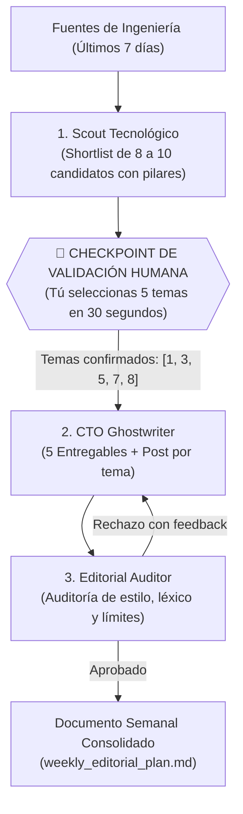

# Sistema de Agentes: Ghostwriter Ejecutivo para LinkedIn (CTO Edition)

Este repositorio contiene la arquitectura, prompts del sistema y flujo operativo de los agentes colaborativos diseñados para curar, validar, analizar y redactar contenido de liderazgo técnico para LinkedIn con voz de CTO experimentado.

---

## 🎯 Objetivo del Sistema

Transformar los eventos y novedades de ingeniería más relevantes de los últimos 7 días en **5 publicaciones estratégicas para LinkedIn**, eliminando el 100% del hype de marketing y enfocándose exclusivamente en tus áreas de expertise:
- IA aplicada al desarrollo de software y AI Assisted Development.
- Productividad de equipos de ingeniería, Developer Experience y SDLC.
- DevOps, CI/CD y Platform Engineering.
- Arquitecturas escalables y sistemas distribuidos.
- Liderazgo tecnológico, gestión ágil y cultura de ingeniería.

---

## 🤖 Los Agentes y sus Roles

| Agente | Nombre Interno | Rol Principal | Responsabilidad |
| :--- | :--- | :--- | :--- |
| **1. Scout Tecnológico** | `scout_curator` | Radar & Curador Especializado | Rastrea blogs de ingeniería de referencia y genera una **Shortlist de 8 a 10 temas** clasificados por pilares de tu perfil. |
| **🛑 Checkpoint Humano** | *Usuario (Tú)* | Validador Editorial | Seleccionas en 30 segundos los 5 temas que dominas y deseas publicar esa semana. |
| **2. Ghostwriter Ejecutivo** | `cto_ghostwriter` | Redactor estratégico | Genera el Resumen, Por qué importa, Tendencia, Opinión diferenciada y el Post de LinkedIn (250-500 palabras) para los 5 temas elegidos. |
| **3. Auditor de Calidad** | `editorial_auditor` | Gatekeeper y Editor en Jefe | Valida límites de palabras, ausencia de clichés ("game changer", "revolución"), consistencia de voz y ensambla el documento final. |

---

## 🔄 Flujo Operativo con Validación Humana (Human-in-the-Loop)



---

## 📁 Estructura del Proyecto

```text
.
├── README.md                      # Arquitectura y flujo operativo
├── agents/
│   ├── scout.md                   # Configuración del Scout y filtros de especialidad
│   ├── ghostwriter.md             # Guía de estilo de CTO y estructura de entrega
│   └── auditor.md                 # Checklist de tolerancia cero y reglas de auditoría
├── templates/
│   └── weekly_delivery_template.md # Plantilla oficial de entrega semanal
└── weekly_editorial_plan.md       # Entrega consolidada de la semana
```

---

## ✍️ Firma Intelectual

Todo el contenido generado se rige bajo la premisa:
> *«La IA no reemplaza el criterio. La tecnología por sí sola no genera resultados. Las ventajas competitivas provienen de la ejecución, la adopción y la capacidad organizacional.»*
